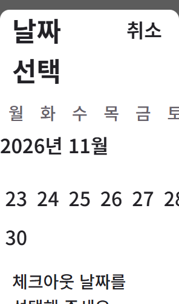
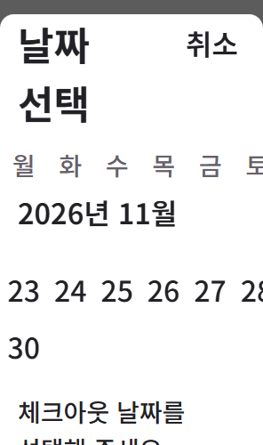

# Sticky month-label gutter correction

The prior [C5 checkpoint](../calendar-legibility/README.md) fixed enlarged date separation but retained V-C5-05: a panned month label lost the existing 20px gutter when the actual scroll owner changed. The new CSS changes only the flow-mode sticky offset to the existing page-inset token. Fixed mode,fonts,dates,controls and spacing tokens remain.

The 72-condition actual geometry check improves six failures to zero. Four actual flow-state inspections now pass the new main-contract relation. The retained 15-stage replay also passes on these exact source bytes,including controller,search/trip callers,fonts,calendar states,scroll,resize and existing request recovery. There are now 87 declared relations;this study does not approve all of them or the full75-rule catalog.

Actual local Qwen first returned a malformed selector and was rejected. A second request returned one typed CSS value. The host froze the actual selector/property and assembled the validated value with PostCSS. The [raw records](evidence/local-attempts.json) distinguish these attempts. One constrained value slot is not independent design,repeatability or reference-quality proof. Existing C5 host assistance remains disclosed.





From the repository root,after npm ci and setting CHROME_PATH to your installed Chrome:

```powershell
node evals/results/stay-booking-20261016/calendar-legibility/checks/replay.mjs
node evals/results/stay-booking-20261016/calendar-gutter/checks/gutter.mjs evals/results/stay-booking-20261016/request-consumers/source runs/gutter-check-1
node evals/results/stay-booking-20261016/calendar-gutter/checks/flow-contract.mjs evals/results/stay-booking-20261016/request-consumers/source runs/gutter-contract-1
node evals/results/stay-booking-20261016/request-consumers/serve.mjs
```

Use fresh output directories for repeated runs. These checks and saved UI inspection perform no inference. New Qwen generation requires Ollama; its exact model/settings/source-bound prompts are in the records. All model requests completed normally;the rejected selector was not a timeout.

This is a bounded correction within the same inspected UI Bowl calendar round. No new native observation,CSS,font,DPR or hidden interaction is inferred. Shared selected navigation paint,request editing,full product catalog/guide validation,real devices/assistive technology and repeated complex-product reference parity remain unfinished. Original C5 failures and independent75-rule/eight-guide review stay historical and are not relabelled.
