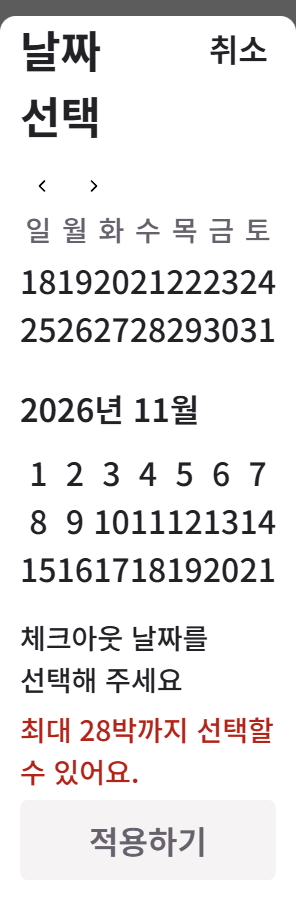
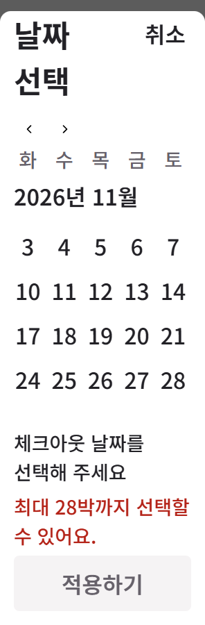

# Direct calendar comparison

Status: changes-needed for the overall product. The scoped enlarged-grid defects below are corrected in the published C5 source; this is not full native fidelity or commercial approval.

The same-round UI Bowl Airbnb calendar has a white rounded selection surface,strong question,weekday labels,left month captions,seven-column dates and vertically consecutive months. Its flexible-date controls and hidden behavior are outside this fixed-date product contract. Original CSS,font,DPR and selected-range behavior remain unknown. The fictional trip dates,custom selected colors,web arrows,Cancel/Apply copy and enlarged-grid pan are chosen adaptations,not recovered native facts.

At390px normal text,the current capture preserves seven aligned date columns,month/date hierarchy and separate summary/action. At296px200% text,the old labels nearly concatenate. The correction keeps32px dates and separates neighboring two-digit values;all columns remain in the same grid and are reachable by bounded horizontal pan. Shared weekday tracks and a whole sticky month label retain context. This does not require all seven enlarged columns to be visible simultaneously.

At500px height,the grid and complete footer are different reachable scroll positions. Cancel remains visible,focus and region End reach the dates and footer,and the error/Apply stack remains intact. Directly inspected normal,enlarged,error,last-date,footer and resized captures supplement the geometry/font receipts. Range boxes alone do not prove ink,clipping,scroll reachability or native similarity.

The initially lingering previous-month caption was diagnosed by direct capture. The first focusin reveal repair broke real pointer selection;the final implementation reveals the month after render/click and preserves normal nearest-date focus. Both failed and corrected receipts remain separate.

Current scoped findings: CAL01 enlarged date separation corrected;CAL02 tested browser short-height/resize recovery corrected while device/AT remain unknown;CAL03 calendar-connected scope contradiction corrected;CAL04 shared selected navigation paint still unverified. The original75IDs/check kinds and eight-guide limits remain in the independent coverage record. Existing request-edit and repeated reference-quality objectives remain open.

V-C5-05 — confirmed,follow-up required: in the296px/500px enlarged last-date capture,the horizontally sticky month label reaches the flow scroll owner's left edge instead of retaining the20px content gutter. The label remains whole and reachable,so the existing containment/scroll checks pass their stated scopes;they do not approve this alignment. Preserve this source-bound checkpoint and add a flow-owner gutter contract before the next correction. Do not call the calendar visually complete.
