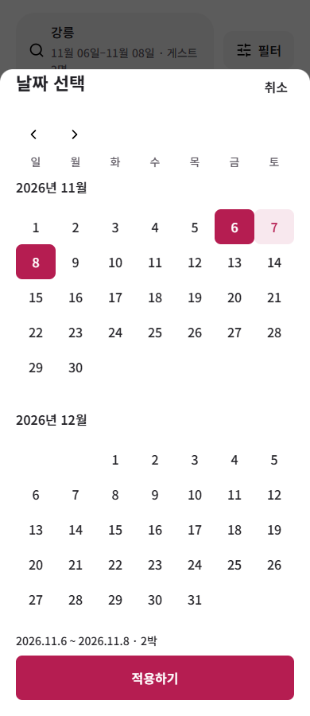

# Integrated calendar study

Reference-level quality remains **INCOMPLETE**. This adds an actual calendar to the complex accommodation search/room/rate/request product. It is a product adaptation of the inspected Airbnb calendar composition,not an exact native reproduction or an independent all-Qwen benchmark.

The existing labeled date inputs remain editable. Each search/trip form also has one official CalendarDays launcher. The calendar owns an isolated draft;Cancel/Escape discard it,Apply updates the two caller draft fields,and the parent form applies query/rate changes. Browser return dismisses both nested surfaces and restores destination focus. Checkout dates remain read-only. The mobile390px cap applies in wide browsers.



## Verified scope

| Check | Result |
| --- | --- |
| Date semantics | 16 groups passed |
| Every supported month | 1,200 months/36,525 dates per timezone;Seoul andLos Angeles |
| UTC keyboard resolver | 24 cases passed |
| Actual safe renderer DOM | 7 groups passed |
| Dialog/controller/reentry/shortcuts | 14 groups passed |
| Isolated layout/fonts/stress,including visible range error | 36 captures passed |
| Actual caller integration | 7 groups passed |
| Integrated search/trip rendering,icons and stress | 24 groups/48 captures passed |
| Existing query/favorite/recovery | 15 groups passed |
| Existing room/rate/trip | 12 groups passed |
| Existing request/storage/cancel/other-tab recovery | 35 groups passed |
| Repository Node tests at this checkpoint | 195 passed |

These results cover their stated scopes. They do not approve aesthetics,all 75 active rules,device/assistive-technology behavior or reliable commercial parity. Historical checker labels such as B1 and their old unfinished-feature descriptions are retained as coverage descriptions;the separate calendar receipts cover this addition.

## Attribution and failures

Actual local model calls used `qwen3.6:35b-a3b-coding` through Ollama,with thinking disabled and 16 GPU layers. Exact per-attempt settings,text,hashes and responses are in [local-attempts.json](evidence/local-attempts.json). Native image payloads are replaced with decoded-byte hash receipts;these records are not directly executable requests.

Qwen supplied the date function bodies,one UTC expression correction,the accepted renderer and the initial/bounded CSS. Host assistance supplied explicit date guards,UTC getters,a primitive-month guard,keyboard/lifecycle runtime,CSS ownership/error/word-wrap corrections,and caller assembly. [Attribution](evidence/attribution.json) lists those boundaries. No host fix is described as Qwen-generated or unattended success.

The first controller passed 3/11 groups. A second controller and the narrow focus attempt remained invalid. First CSS failed 24/24 captures;its bounded repair passed 12 blank captures while 12 range captures still had unknown contrast,plus directly observed ownership/error/word-wrap defects. Those attempts remain failures/unknowns. One first integration batch was invalidated when the host changed source mid-run;the binding assertion rejected it and its counts are not used.

## Reference review

The [reference receipt](evidence/reference.json) records the live UI Bowl retrieval,screen IDs,links and native hashes. Native images and signed URLs are not distributed. All five gallery images were inspected;the selected calendar image was1125×2436. The output retains seven aligned columns,vertical month progression,month/day hierarchy,quiet past dates and a distinct lower action. Original fonts/CSS/DPR,selected-range appearance and hidden behaviors remain unknown.

The native image shows December from 17 in its captured viewport;the cause is unknown. The web component keeps all dates in an explicit scroll region. Its Noto font,web arrows,Cancel/Apply,selected colors and omitted flexible-date/search context are chosen adaptations. Their existence is not exact-reference fidelity. See the [visual review](evidence/visual-review.md) and [viewport note](evidence/reference-viewport-note.md).

## Reproduce the scoped checks

Install the repository dependencies with `npm ci`. Set `CHROME_PATH` to an installed Chrome/Chromium executable,then run from the repository root:

```powershell
node evals/results/stay-booking-20261016/calendar/replay.mjs
```

Optional arguments are the target source directory and a new output directory. The default source is [the published runnable product](../request-consumers/source/index.html);the default output is a new directory under `runs`. Serve that source with an ordinary local HTTP server for interactive use. The replay uses isolated browser contexts and injected storage faults;it does not call Ollama or book real accommodation.

Published replay checkers adapt private round fixture/helper paths for a clone. Their own hashes and fresh output belong to a separate replay receipt;they are not retroactively substituted for the original generation inputs/checker hashes.

Remaining work includes request editing,full product75-rule/eight-guide revalidation,other complex-service transfer and repeated independent reference-level comparisons. Previous shared navigation paint unknowns remain unresolved. More passing functional checks do not establish convergence.

The [fresh published-checker replay](evidence/replay/report.json) passed all12 stages against the exact published runtime,including both timezone matrices. It records source,harness and checker hashes. Representative actual font receipts are included;the replay generates every capture and full font receipt locally.
