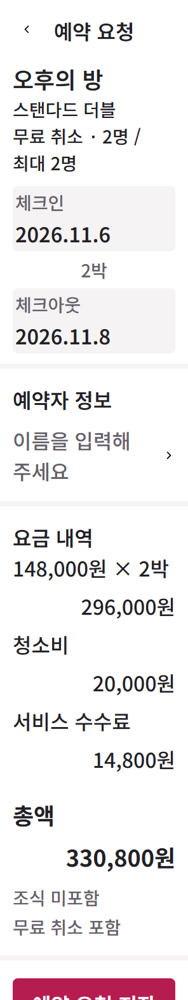
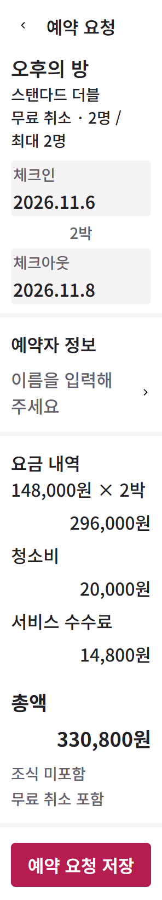

# Wait for actual observer reflow before capture

Status: verified capture-harness repair,**not whole UI/reference approval**. Code:8193cc8.

A read-only UI review found the296px200%candidate image cut off its save action:PNGheight1568while the settled document was1638. The actual UI was not clipped;the snapshot used the old height before its ResizeObserver/animation-frame layout finished. Original bad image and report are retained here. The candidate is a private unfinished booking-core diagnostic;its Save handler is not implemented. This artifact does not present it as a usable booking release.

Text-stress inspection now waits for loaded fonts and two consecutive unchanged geometry frames,with a12frame budget. Exhaustion remains UNVERIFIED and creates a required service-review finding. Geometry stability does not prove paint/network completion,realdevicezoom or designquality.

Fresh after-capture is296x1638and contains the complete action(groupbottom1638). All4stresscaptures in after-report.json settled in3–5frames,each with9/9tokenchecks and0actualfont/layoutFAIL. Normal4widths are separate observations. The before/after rendering inputs(index,styles,room/booking/guest/trip/controller/appmodules) were byte-equal;the new unrelated unreferenced reducer file was not part of the rendering path. Exact source/harness digests are retained. No native reference image or side-by-side containing native pixels is published.

Unit evidence:initial0/2;first implementation1/2because the test demanded a literal nullstyleattribute despite Playwright leaving an empty attribute. That assertion was replaced with actual authored16pxfont restoration/noinlinefont override. Final2/2and full167/167,zero skip/cancel. The initial logs remain. Raw log whitespace is preserved with local artifact attributes;private stack paths have redaction receipts.

